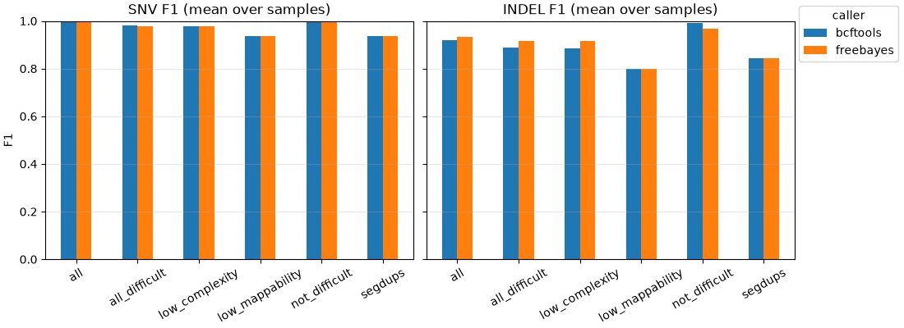

# callbench

A Snakemake workflow that finds small inherited DNA variants in short-read
sequencing data and measures how often it gets them right, using reference
genomes whose true variants are already known.

## What this is for

Everyone carries a few million small differences from the human reference
genome: single-letter changes (SNVs) and short insertions or deletions
(indels). A few of them, in genes such as BRCA1 and BRCA2, change a person's
cancer risk and their care. Finding them from sequencing reads is called
germline variant calling, and the software that does it (a "caller") makes
mistakes: it misses real variants (false negatives) and reports variants that
are not there (false positives).

The Genome in a Bottle consortium (GIAB) publishes reference samples, such as
HG002, whose variants have been worked out with many technologies. Running a
pipeline on HG002 and comparing its output with the GIAB answer key gives
precision (how many reported variants are real), recall (how many real
variants were found) and their combination, F1. Doing this per region type
(easy sequence, repeats, duplicated sequence) shows where a pipeline is
weak. A clinical lab validates its pipeline this way before reporting on
patients, and again after every software change.

This workflow does that for two callers, bcftools and FreeBayes, on HG002
reads around BRCA1 and BRCA2, and reports accuracy, runtime and memory side by
side.

## Results (v1.0.2, HG002, 3.8 Mb around BRCA1 and BRCA2)

| Caller | SNV recall | SNV precision | SNV F1 | Indel recall | Indel precision | Indel F1 |
| --- | --- | --- | --- | --- | --- | --- |
| bcftools 1.24 | 0.9965 | 0.9979 | 0.9972 | 0.9117 | 0.9254 | 0.9185 |
| FreeBayes 1.3.10 | 0.9953 | 0.9951 | 0.9952 | 0.9087 | 0.9560 | 0.9318 |

3,412 truth SNVs and 657 truth indels inside the GIAB confident regions; about
29x mean depth. The tables behind these numbers are in `docs/results-v1.0.2/`.
Per-stratum numbers, runtime and memory are in `docs/validation.md`; the deployment recommendation is in
`docs/evaluation/caller_evaluation.md`. These numbers describe two 1.9 Mb windows
picked for their genes, not the whole genome.



F1 per GIAB stratum from `docs/results-v1.0.2/accuracy.tsv`, drawn by
`f1_figure` in `workflow/scripts/plots.py`, the code that makes this figure in
the HTML report. Indels in low-mappability regions and segmental duplications
are where both callers lose most.

## Quick start (bundled test data)

Needs Python 3.12 (what CI uses) and conda 24.7.1 or later on `PATH`. On
Python 3.14, pip builds one Snakemake dependency (`immutables`) from source and
needs a C compiler.

```
git clone https://github.com/Daneshpajouh/callbench
cd callbench
python3 -m venv .venv
.venv/bin/pip install -r requirements-dev.txt
make test-workflow
```

This runs every rule on a 200 kb slice of chr17 around BRCA1 (19,856 HG002
read pairs, 5.5 MB in `.tests/integration/data/`) and then compares the
accuracy table with `.tests/expected_accuracy.tsv`. On the build machine the
first run took 102 s, most of it building eight conda environments; later runs
took 29 to 48 s. The last lines of a passing run:

```
44 of 44 steps (100%) done
run summary written to results/run/summary.json
```

Results are in `.tests/integration/results/`; `report/accuracy.tsv` is the
accuracy table.

## Running on real data

```
make data          # region fetch of the public inputs, about 800 MB
make run           # full run, 8 cores
make report        # results/report.html
```

`make data` needs `curl`, `samtools`, `bcftools`, `tabix` and `shasum` on
`PATH`. It does not fetch ClinVar: NCBI's HTTPS host disallows
scripted downloads in robots.txt. Before `make run`, put the GRCh38
`clinvar.vcf.gz` and its `.tbi` from NCBI's FTP endpoint
(`ftp://ftp.ncbi.nlm.nih.gov/pub/clinvar/vcf_GRCh38/`) in
`resources/full/clinvar/`; `docs/data_sources.md` records the release used.

On a Slurm cluster, set `slurm_account` and `slurm_partition` in
`profiles/slurm/config.v8+.yaml` and run
`.venv/bin/snakemake --profile profiles/slurm`.

### Before and after a real run

* Compare `MANIFEST.tsv`, which `make data` writes, with the SHA-256 values
  in `docs/data_sources.md`. A mismatch on reads or truth files means the
  source changed.
* `--conda-create-envs-only` does not build the calling environments: those
  rules sit behind the scatter checkpoint and are not in the DAG until it has
  run. A solver failure then stops the run halfway (it happened once; see
  `docs/operations/runbook.md`). Run `make test-workflow` first, which builds
  every environment.
* After the run, compare the `all` rows of `results/report/accuracy.tsv`
  with `docs/validation.md`. A drop of more than 0.005 in F1 for any caller
  and type is a regression. Peak memory per rule in
  `results/report/profiling.by_rule.tsv` should stay under the `mem_mb` the
  rule asked for; if not, raise the coefficients in
  `workflow/rules/common.smk`.
* To rerun an analysis later you need the report, `config/`, the inputs'
  `MANIFEST.tsv` and the git commit.

## Containers

`Dockerfile` is the output of `snakemake --containerize` with the base image
pinned by digest: one prebuilt conda environment per rule. The 1.0.0 image was
built on 2026-10-19 for linux/amd64 (`docker build --platform linux/amd64
-t callbench:1.0.0 .`, 3 min 15 s under emulation, 1.05 GB). The integration
test (HG002 reads on a 200 kb slice of chr17, both callers, vcfeval and the
accuracy check) ran inside that image with no network twice: on a workstation,
and as an Apptainer image on a Slurm compute node, 44 of 44 steps each time
with the same accuracy table. The 1.0.2 code passed the same test in that
image.

The release workflow builds the image from the current Dockerfile (bcftools
1.24) and publishes it when a version is tagged:
`ghcr.io/daneshpajouh/callbench:v1.0.2`. The integration test ran inside that
image in GitHub Actions on 2026-10-19 (`.github/workflows/image-test.yml`, 44 of
44 steps, accuracy check passed). On a Slurm cluster with Apptainer, add
`containerized: "docker://ghcr.io/daneshpajouh/callbench:v1.0.2"` to the
Snakefile and run with `--sdm conda apptainer`.

## How it works

```
FASTQ -> fastp -> bwa mem | fixmate | sort -> markdup -> samtools stats, mosdepth
                                                |
                     scatter_intervals (checkpoint: chunks of <= 500 kb)
                                                |
                       bcftools  |  FreeBayes   (one job per chunk)
                                                |
                    gather -> normalise -> vcfeval vs GIAB v4.2.1 -> strata
                                         \-> ClinVar annotation
                                                |
                  accuracy, QC, profiling tables -> snakemake --report
```

Software comes from pinned per-rule conda environments in `workflow/envs/`.
`bwa mem -K 100000000` fixes the batch size, so the alignments do not depend on
the thread count and the regression test stays deterministic. The gather step
uses `bcftools concat --allow-overlaps --remove-duplicates`, because a deletion
that starts near a chunk boundary can be called in both neighbouring chunks.
Each heavy rule has a `benchmark` directive; `results/report/profiling.tsv`
collects them. Memory and runtime requests are functions of input size and
grow on retry. The config and samplesheet are checked against JSON Schemas
before a job is planned.

## Repository layout

| Path | Contents |
| --- | --- |
| `workflow/` | Snakefile, rules, envs, schemas, scripts, report captions |
| `config/` | config, samplesheet and evaluation intervals for the full run |
| `profiles/` | `local`, `slurm` and `test` Snakemake profiles |
| `tools/` | data fetch, test-data builder, accuracy regression check, macOS benchmark wrapper |
| `tests/` | pytest unit tests for the scripts and workflow-level tests |
| `.tests/` | bundled test data and the integration config |

## Documentation

* `docs/validation.md`: accuracy against GIAB with commands and limits.
* `docs/testing.md`: test layers and how to run each.
* `docs/evaluation/caller_evaluation.md`: which caller to deploy and why.
* `docs/capacity_planning.md`: measured costs and a labelled projection to
  hundreds of genomes on Slurm.
* `docs/data_sources.md`: every input with URL, size and SHA-256.
* `docs/operations/`: failures met while building v1.0.0, with causes and
  fixes, and the one postmortem.
* `ROADMAP.md`, `CHANGELOG.md`, `CONTRIBUTING.md`.

## Licence and citation

Apache-2.0. Cite with `CITATION.cff`. The workflow uses public GIAB, GA4GH
stratification and ClinVar data; cite those resources as listed in
`docs/validation.md`.
